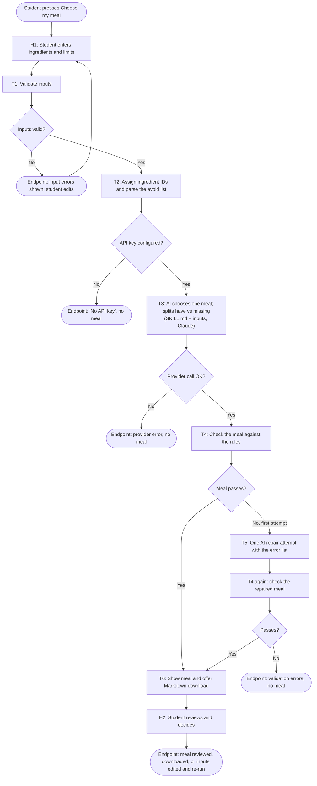

# PantryPick Workflow and Design

## 1. System goal

**For** a student deciding what to eat from a partly stocked kitchen, **help them pick one meal they
can actually make and understand what they have, what is missing and what that changes**, **measured
by** the student's own "I know what to cook and what, if anything, to buy" rating (1 to 5) and the
minutes it takes to decide, moving from **a baseline to be recorded by the team before the demo
(the student's rating and time without the app)** to **a proposed target of 4 or higher in under
3 minutes**, **without** exceeding the cooking time or budget, using a food the student asked to
avoid, assuming ingredients they did not list, placing orders or purchases, or giving allergy,
medical or nutrition advice.

The baseline and target are proposals. Nothing has been measured yet.

| Part | Answer |
|---|---|
| Beneficiary | A student choosing a meal from what is on hand, under time and money limits |
| Outcome | One feasible meal, a clear have / missing split, and the effect of any gaps |
| Measure | Self-rated clarity (1 to 5) and time to decide; baseline not yet recorded |
| Boundary | Uses only what the student typed; respects time, shopping, budget and avoid list; suggests only, takes no outside action, gives no health advice |

## 2. Trigger and endpoint

- **Trigger:** the student presses **Choose my meal** (or **Choose a different meal**) after entering
  ingredients and limits.
- **Workflow endpoints:** (a) a checked meal is on screen with a Markdown download, ready for the student
  to review; or (b) a clear error is shown and no meal is shown (bad input, missing key, provider
  failure, or an answer that failed the checks twice).

## 3. Workflow sketch

## 4. Tasks

Task types and levels use the course vocabulary (Retrieve, Sense, Reason, Decide, Act, Verify, Remember,
Learn; Levels 0 to 3).

| Task | Input | Output | Performer | Task type | Level |
|---|---|---|---|---|---|
| H1 Enter ingredients and limits | Student's own knowledge | Ingredient rows, minutes, shopping choice, budget, preferences, avoid list | Student | Retrieve (student supplies the material) | 0 Manual |
| T1 Validate inputs | Raw form values | Valid `MealRequest` or list of errors | App code | Verify | 1 Rule-based |
| T2 Prepare the request | Valid inputs | Stable ingredient IDs (I1, I2, ...), parsed avoid terms | App code | Reason (rule-based preparation) | 1 Rule-based |
| T3 Choose a meal | SKILL.md and the request | JSON: meal, why, ingredients used, missing items with importance, cost and effect, steps, alternatives, assumptions, missing information | Claude (`claude-opus-5-5`) | Reason (interprets free-text names and preferences, then draws a conclusion) | **2 Intelligent automation** |
| T4 Check the meal | JSON answer and the request | Accepted meal or error list | App code | Verify | 1 Rule-based |
| T5 Repair (at most once) | Request, rejected answer, error list | New JSON answer | Claude | Reason | 2 Intelligent automation |
| T6 Show meal, offer download | Accepted meal | Review screen and `.md` file | App code | Act (produces the output the student uses) | 1 Rule-based |
| H2 Review and decide | Displayed meal | Cook it, edit inputs and re-run, or ignore | Student | Decide | 0 Manual |

**Not used:** Remember and Learn. The app keeps nothing after a run and does not revise its own guidance.
Sense is not a separate task because interpreting the student's free text happens inside T3.

### What the code checks (T4)

- Every ingredient the meal uses is one the student entered (by ID), with no repeats.
- Step minutes are positive and add up to at most the available time.
- An item the student already has is not listed as missing (exact-name check, so "rice vinegar" is fine when
  the student has "rice").
- `needs_shopping` is true exactly when an essential item is missing.
- If the student cannot shop, no essential item is missing.
- If shopping is allowed and a budget is given, the estimated cost of missing items stays within it.
- No food on the avoid list appears in the meal name, steps, uses or missing items (whole-word, singular or plural).
- All required fields are present, with no extra fields, and at most three alternatives.

### Why T3 is Level 2 and not Level 3 (ARC)

- **A, Action openness:** not met. The path is fixed: one request, one response in a set schema.
- **R, Runtime adaptation:** not met. The model's output never changes which step runs next. The retry
  is a fixed single repair triggered by code.
- **C, Containment:** the app enforces limits (one repair, time and budget checks, no tools), but
  containment alone does not make a task Level 3.

The model has no tools and cannot choose its own steps. It interprets and generates inside a predefined
path, which is Level 2. We make no Level 3 claim.

## 5. Coding assistant vs. the model inside the app

- **Coding assistant (Claude Code):** used while building. It wrote and tested the code, SKILL.md and these
  documents. It is not in the running app and makes no runtime decisions.
- **Model inside the app (Claude via the Anthropic API):** called by `planner.py` each time the student
  presses the button, using the team's API key on the server side. It sees only SKILL.md and the
  student's inputs.

## 6. Provider and model

- **Provider:** Anthropic Claude API, official `anthropic` Python SDK (1.15.0). A Claude Code or Claude.ai
  login does not provide this API access; a separate API key is required.
- **Model ID:** `claude-opus-5-5`, copied from Anthropic's models overview page on 2026-10-22.
- **Why it fits:** the task needs common-sense cooking judgment (what can substitute for what, what is
  essential) over messy free text, plus strict output format. The model supports JSON schema output, and
  effort is set to `medium` to keep a short call quick. A cheaper model can be tried through `PANTRYPICK_MODEL`.

## 7. Tools and their operations

| Tool | Operation (input → output) | Permission |
|---|---|---|
| Anthropic Messages API (via SDK) | `messages.create(model, system, messages, output_config)` → JSON text | Read-only request using an API key; changes nothing outside the response |
| Streamlit | Renders table editor, inputs, buttons, meal display, `download_button` | Local only |
| Pydantic | Parses the model's JSON; rejects missing or extra fields | None |
| python-dotenv | Loads `ANTHROPIC_API_KEY` from local `.env` | Reads one local file |
| pytest + Streamlit AppTest | Run automated tests | Local only |

No MCP server and no grocery, recipe, calendar or email tools are connected. The model is given no tools.

## 8. Skill decision: included (`SKILL.md`)

- **Task it supports:** T3 and T5, the meal-choosing step.
- **What changes each run:** the ingredients, time, shopping choice, budget, preferences and avoid list.
- **What stays stable:** the procedure, how to classify missing items as essential or optional, how to
  respect constraints, the output schema, the boundaries (no assumed ingredients, no health claims), and
  how to handle missing information.
- **Why it helps:** it keeps answers in the same shape and under the same rules every time, a teammate can
  improve the rules without touching code, and reviewers can read exactly what the model was told. It does
  not guarantee identical wording or good meals, so the code also checks the output.
- It has a name and description (Discover) and states inputs, procedure, output format, boundaries and
  missing-information handling (Instructions). There are no supporting files.
- It is a plain file this app reads, not an installed Claude Code skill.

## 9. Limitations

- Suggests one meal per run. It keeps no history, does not plan a week and does not learn preferences.
- Times and prices are estimates. The model cannot know local prices, and it cannot see amounts or freshness
  beyond what the student typed.
- Code checks structure, limits and the avoid list. Whether the meal tastes good or the steps are safe and
  correct needs a human. Students should always check food labels and follow their own health guidance.
- The avoid list is a text match. It can miss hidden ingredients (for example an allergen inside a sauce)
  and it is not an allergy safeguard.
- No nutrition, calorie or health claims are made or checked.
- Needs internet and a paid API key; each suggestion costs a small amount.
- Not tested with real students. The success measure above is proposed, not measured.
