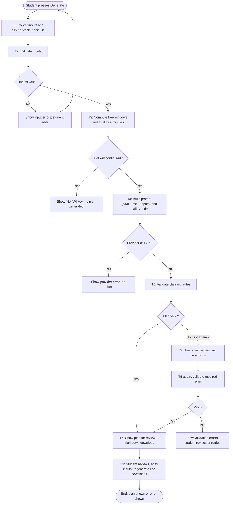

# RoutineShift Workflow and Design

## 1. Goal

| Item | Answer |
|---|---|
| **Beneficiary** | A student whose classes, work shifts, or unexpected events changed today's available time. |
| **Outcome** | The student keeps the habits that matter most (at least in a minimum version) instead of dropping the whole routine, and knows the first thing to do. |
| **Proposed measure** | Per-student, over two weeks: the share of days with at least one High-priority habit done (self-reported check-off), compared with a week without the app. A product measure is the share of generated plans that pass validation on the first attempt (target ≥ 90%). Neither has been measured yet. |
| **Boundary** | Plans one day using only what the student types. No calendar, reminder, messaging, or health-record access. No medical advice. A human (the student) decides whether to follow the plan. |

## 2. Trigger and endpoint

- **Trigger:** The student presses **Generate adjusted plan** (or **Regenerate plan**) after entering or editing today's inputs.
- **Endpoint:** Either (a) a validated plan is shown with a Start-here action, schedule, explanation, deferred list, assumptions and missing information, and is available as a Markdown download, or (b) a clear error is shown (input problem, missing key, provider failure, or plan rejected after one repair) and no plan is shown.

## 3. Workflow sketch

## 4. Tasks

| Task | Input | Output | Performer | Task type | Automation level |
|---|---|---|---|---|---|
| T1 Collect inputs and assign IDs | Table rows, day window, note | Rows with stable IDs (H1, H2, …) | App code | Data handling | Level 1, rule-based |
| T2 Validate inputs | Rows | `DayInput` or list of errors | App code | Validation | Level 1, rule-based |
| T3 Compute free time | Day window, commitments | Free windows, total free minutes | App code | Calculation | Level 1, rule-based |
| T4 Generate plan | `SKILL.md`, inputs, free windows | JSON plan | Claude model (`claude-opus-5-5`) | Judgment: prioritise, shorten, sequence, explain | **Level 2, intelligent automation** |
| T5 Validate plan | JSON plan, inputs | Accepted plan or error list | App code | Validation | Level 1, rule-based |
| T6 Repair (at most once) | Inputs, rejected plan, error list | New JSON plan | Claude model | Judgment, constrained by errors | Level 2 |
| T7 Present and export | Accepted plan | Review screen and `.md` file | App code | Presentation | Level 1 |
| H1 Review and decide | Displayed plan | Follow, edit, regenerate, or ignore | Student | Human decision | Manual (human in the loop) |

**Why Level 2, not Level 3.** The AI performs one fixed task, generating a plan, inside a workflow
the code defines. It cannot choose its own tools or steps, cannot loop on its own, and
cannot act in the world. The code decides when it runs, what it sees, what counts as
valid, and caps retries at one. The model does not change the process at runtime. It
only fills in judgment inside a fixed step. There is no evidence of dynamic runtime
adaptation of the workflow, so Level 3 would be an overclaim.

## 5. Coding assistant vs. model inside the app

- **Coding assistant (Claude Code):** used at build time to write the code, tests, and
  documents in this folder. It is not part of the running app and makes no decisions
  at runtime.
- **Model inside the running app (Claude via the Anthropic API):** called by `planner.py`
  each time a student presses Generate. It uses the student's own API key and is
  billed per request. It sees only the inputs and `SKILL.md`.

## 6. Provider and model

- **Provider:** Anthropic Claude API through the official `anthropic` Python SDK (v1.15.0).
- **Model:** `claude-opus-5-5`. The ID was checked on Anthropic's models overview
  page on 2026-10-16. Anthropic recommends it as the starting model for most workloads.
- **Why it fits:** The task needs judgment (trade-offs between priority, preferred time,
  fatigue, minimum versions) plus strict format compliance. The model supports
  structured JSON output through `output_config.format`, which makes malformed
  responses rare, and the app still checks every rule. Effort is set to `medium`
  to keep cost and latency reasonable for a short planning task. A cheaper model
  can be set through `ROUTINESHIFT_MODEL`.

## 7. Tools and operations

| Tool | Operations used |
|---|---|
| Streamlit | Render forms (`data_editor`, `time_input`, `text_area`), buttons, plan display, `download_button` |
| Anthropic Python SDK | `Anthropic(api_key=...)`, `client.messages.create(model, system, messages, max_tokens, output_config={effort, format: json_schema})` |
| Pydantic | Parse the model's JSON into typed objects and reject missing or extra fields |
| python-dotenv | Load `ANTHROPIC_API_KEY` from the local `.env` |
| pytest + Streamlit AppTest | Automated tests with mocked model responses |

The model is given **no tools**. It cannot browse, read files, or take actions. It only returns JSON.

## 8. Why reusable planning instructions (`SKILL.md`)

- **One source of truth:** inputs, procedure, priority rules, output schema, boundaries,
  and missing-information handling live in one readable file, not inside Python strings.
- **Editable by non-programmers:** a teammate can improve the planning rules without
  touching code. The app loads the file on every request.
- **Reusable:** the same instructions could drive a different front end (CLI, chatbot)
  or a different model.
- **Auditable:** reviewers can see exactly what the model was told to do and not do.
- It is **not** an installed Claude Code skill. It is a plain file that this app reads.

## 9. Limitations

- Plans one day at a time. There is no history, streak tracking, or learning from past days.
- The model's durations and "minimum versions" are estimates. The app labels them but cannot verify them.
- Plan quality (sensible ordering, good first actions) is checked by people, not by code.
  The code checks only structure, time math, and honesty rules.
- All times are on the same day (no overnight shifts across midnight).
- No travel time between locations unless the student enters it as a commitment.
- Requires internet access and a paid Anthropic API key. Each plan costs a small amount.
- Not tested with real students. The success measure above is proposed, not measured.
- Not a medical, mental-health, or accessibility tool.
