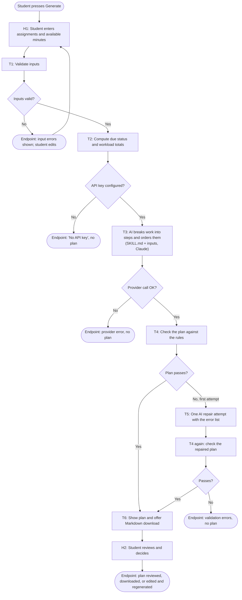

# StudySprint Workflow and Design

## 1. System goal

**For** a student who feels overwhelmed by several assignments, **help them know what to do
first and what fits today**, **measured by** the student's own "I know what to do next"
rating (1 to 5) and the minutes from opening the app to starting the first step, moving from
**a baseline to be recorded by the team before the demo (the student's rating without the app)**
to **a proposed target of 4 or higher and under 5 minutes**, **without** reading a syllabus or
inventing requirements, claiming work fits when it does not, exceeding the stated study time,
or submitting work, messaging anyone or changing a calendar.

The baseline and target are proposals. Nothing has been measured yet.

| Part | Answer |
|---|---|
| Beneficiary | A student with several competing assignments and limited time today |
| Outcome | A clear first action and an ordered, realistic plan for today |
| Measure | Self-rated clarity (1 to 5) and time to start; baseline not yet recorded |
| Boundary | Uses only what the student typed; never exceeds available minutes; plans only, takes no outside action |

## 2. Trigger and endpoint

- **Trigger:** the student presses **Generate study plan** (or **Regenerate plan**) after
  entering assignments and today's study time.
- **Workflow endpoints:** (a) a checked plan is on screen with a Markdown download, ready for the
  student to review; or (b) a clear error is shown and no plan is shown (bad input, missing key,
  provider failure, or a plan that failed the checks twice).

## 3. Workflow sketch

## 4. Tasks

Task types and levels use the course vocabulary (Retrieve, Sense, Reason, Decide, Act, Verify,
Remember, Learn; Levels 0 to 3).

| Task | Input | Output | Performer | Task type | Level |
|---|---|---|---|---|---|
| H1 Enter assignments and time | Student's own knowledge | Table rows, available minutes | Student | Retrieve (student supplies the material) | 0 Manual |
| T1 Validate inputs | Rows, minutes | Valid `StudyDay` or list of errors | App code | Verify | 1 Rule-based |
| T2 Compute due status and workload | `StudyDay` | Days to due, known-minutes total, overload flag | App code | Reason (calculation) | 1 Rule-based |
| T3 Break down and order the work | SKILL.md, inputs, computed workload | JSON plan: Start here, timed steps, explanation, deferred, assumptions, missing info | Claude (`claude-opus-5-5`) | Reason (assess and sequence) | **2 Intelligent automation** |
| T4 Check the plan | JSON plan, inputs | Accepted plan or error list | App code | Verify | 1 Rule-based |
| T5 Repair the plan (at most once) | Inputs, rejected plan, error list | New JSON plan | Claude | Reason | 2 Intelligent automation |
| T6 Show plan, offer download | Accepted plan | Review screen, `.md` file | App code | Act (produces the output the student uses) | 1 Rule-based |
| H2 Review and decide | Displayed plan | Follow, edit and regenerate, or ignore | Student | Decide | 0 Manual |

**Not used:** Sense, Remember and Learn. The app keeps nothing after a run and does not revise its
own guidance, because one session's plan does not need either.

### Why T3 is Level 2 and not Level 3 (ARC)

- **A, Action openness:** not met. The path is fixed: one request, one response in a set schema.
- **R, Runtime adaptation:** not met. The model's output never changes which step runs next.
  The retry is a fixed single repair triggered by code.
- **C, Containment:** the app enforces limits (one repair, a time budget, no tools), but that
  does not make it Level 3. Containment only decides whether adaptation is allowed.

The model has no tools and cannot choose its own steps. It interprets and generates inside a
predefined path, which is Level 2. We make no Level 3 claim.

## 5. Coding assistant vs. the model inside the app

- **Coding assistant (Claude Code):** used while building. It wrote and tested the code,
  SKILL.md and these documents. It is not in the running app and makes no runtime decisions.
- **Model inside the app (Claude via the Anthropic API):** called by `planner.py` each time
  the student presses Generate, using the team's API key on the server side. It sees only
  SKILL.md and the student's inputs.

## 6. Provider and model

- **Provider:** Anthropic Claude API, official `anthropic` Python SDK (1.15.0). A Claude
  Code or Claude.ai login does not provide this API access; a separate API key is required.
- **Model ID:** `claude-opus-5-5`, copied from Anthropic's models overview page on 2026-10-22.
- **Why it fits:** the task needs judgment over messy text (blockers, uncertain estimates,
  trade-offs between deadlines and priorities) and strict output format. The model supports JSON
  schema output, and effort is set to `medium` to keep a short planning call quick. A cheaper
  model can be tried through `STUDYSPRINT_MODEL`.

## 7. Tools and their operations

| Tool | Operation (input → output) | Permission |
|---|---|---|
| Anthropic Messages API (via SDK) | `messages.create(model, system, messages, output_config)` → JSON text | Read-only request using an API key; changes nothing outside the response |
| Streamlit | Renders table editor, number input, buttons, plan display, `download_button` | Local only |
| Pydantic | Parses the model's JSON; rejects missing or extra fields | None |
| python-dotenv | Loads `ANTHROPIC_API_KEY` from local `.env` | Reads one local file |
| pytest + Streamlit AppTest | Run automated tests | Local only |

No MCP server and no calendar, email or file tools are connected. The model is given no tools.

## 8. Skill decision: included (`SKILL.md`)

- **Task it supports:** T3 and T5, the planning step.
- **What changes each run:** the assignments, deadlines, blockers and available minutes.
- **What stays stable:** the procedure, priority rules, the output schema, the boundaries
  (never invent requirements, never overstate), and how to handle missing information.
- **Why it helps:** it keeps plans in the same shape and under the same rules every time, a
  teammate can improve the rules without touching code, and reviewers can read exactly what
  the model was told. It does not guarantee identical wording or correct results, so the code
  also checks the output.
- It has a name and description (Discover) and states inputs, procedure, output format,
  boundaries and missing-information handling (Instructions). There are no supporting files.
- It is a plain file this app reads, not an installed Claude Code skill.

## 9. Limitations

- Plans one session at a time. It keeps no history and does not learn from past days.
- Step minutes are estimates, and the model's guesses for unknown work cannot be verified.
- Code checks structure, time math and honesty rules. Whether the steps are actually good advice
  needs a human, and the student is the final reviewer.
- It cannot see assignment instructions, so it can only break work into generic, sensible steps
  based on the names and notes the student types.
- Does not schedule specific clock times or breaks, or model sleep, travel or other classes.
- Needs internet and a paid API key; each plan costs a small amount.
- Not tested with real students. The success measure above is proposed, not measured.
